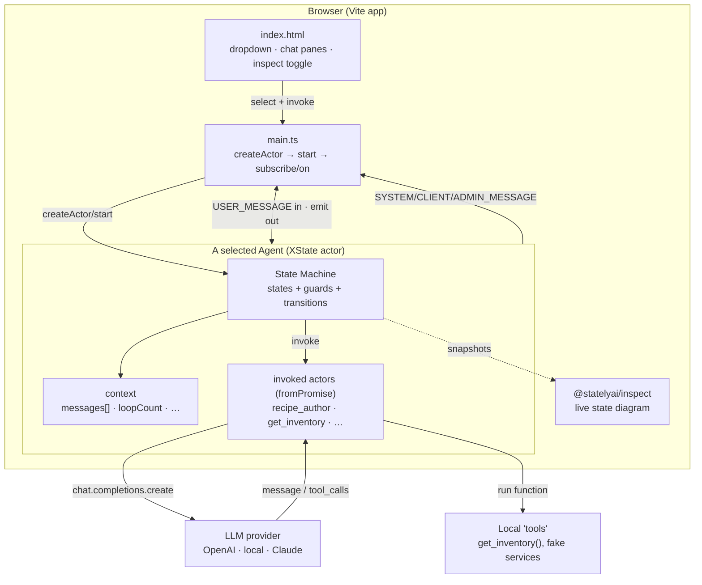
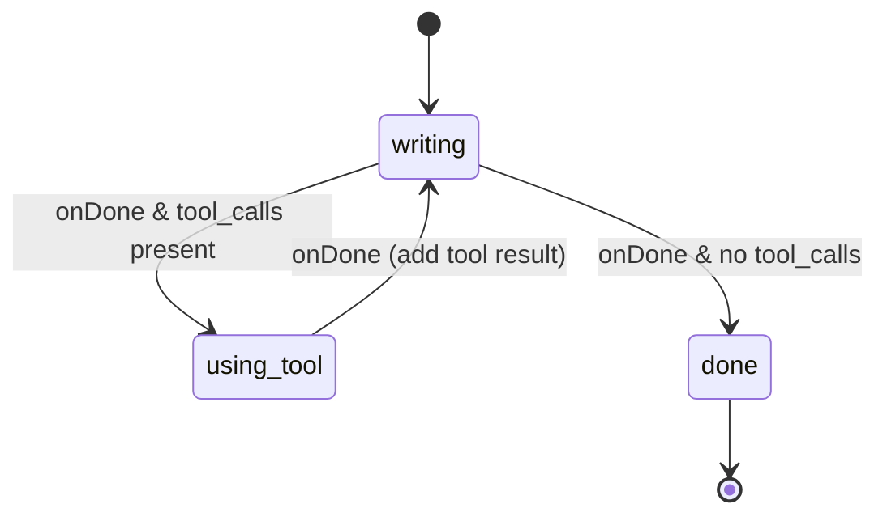
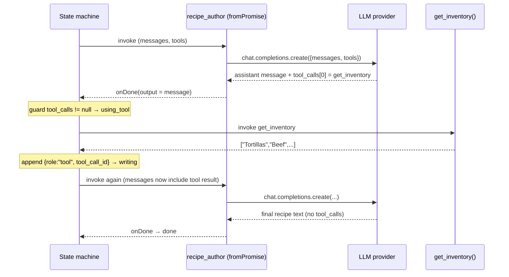

# Agentic State Machines — Learning Guide

A practical, read-it-once guide to understanding this repo, the architecture behind
it, and how to run the exact same agents against **OpenAI**, a **local LLM**, or
**Claude**.

> **One-line mental model:** an *Agent* here = **an Actor** (mailbox + lifecycle)
> **+ a State Machine** (deterministic control flow) **+ an LLM** (the stochastic
> brain). The state machine is the skeleton; the LLM is only invoked *inside* a
> state, and its output just decides *which transition fires next*.

---

## 1. What this project is

It's a browser app (Vite + TypeScript) that demonstrates common **agentic AI
patterns** built on [XState v5](https://stately.ai/docs) finite state machines
instead of a framework like LangGraph / AutoGen / CrewAI. The thesis (see
`README.md`): FSMs make agents **observable, predictable, resilient, and
language-agnostic**, while the LLM supplies creativity where you actually want it.

Each pattern is a self-contained state machine ("actor") under `src/actors/`:

| Pattern | File | What it teaches |
|---|---|---|
| **Writer w/ Tool Use** | `writer/writer.ts` | A state per tool phase: `writing → using_tool → writing → done` |
| **Reflection** | `reflection/reflection.ts` | Two agents (writer ↔ critic) looping with a bounded `maxLoopCount` |
| **Collaboration / Orchestration / Routing** | `collaboration/collaboration.ts` | A central planner LLM picks the next specialist via `tool_choice: "required"` |
| **Human-in-the-Loop** | `human_in_the_loop/human_in_the_loop.ts` | A tool call pauses in `approval_required` until a human sends `approve`/`deny` |
| **Chat w/ Agent** | `writer_chat/writer_chat.ts` | The HITL pattern driven interactively from the UI |
| **Chartering / Code Execution** | `code_execution/code_execution.ts` | Generates a *novel* machine at runtime and spawns it |

The entry point `src/main.ts` renders a dropdown of these agents, lets you tweak
their JSON `input`, spawns them with `createActor(...)`, and streams their
`emit`-ted messages into the two chat panes (user side + operator/admin side).
`@statelyai/inspect` gives you a live state diagram when the "inspect" box is checked.

---

## 2. Tech stack

```
Vite 5            dev server + bundler (reads VITE_* env vars into import.meta.env)
TypeScript 5.6    all actors are typed state machines
xstate 5.19       the FSM / actor runtime
@statelyai/inspect   live visual debugger for running machines
openai 4.73       the only LLM client today (talks to api.openai.com)
express/socket.io present in deps for a server variant (not central to the demos)
```

---

## 3. System design

### 3.1 Runtime architecture (the big picture)



ASCII equivalent of the same flow, for terminals that don't render Mermaid:

```
  [ UI dropdown ] --select--> [ main.ts ] --createActor/start--> [ Agent FSM ]
         ^                         |                                   |
         | emit(CLIENT/ADMIN)      | send(USER_MESSAGE)                | invoke
         |                         v                                   v
  [ chat panes ] <------------ [ main.ts subscribe ]           [ fromPromise actor ]
                                                                 |            |
                                                      chat.completions     run tool fn
                                                                 |            |
                                                                 v            v
                                                           [ LLM provider ] [ local tools ]
```

**Key idea:** the LLM is never "in charge." It is called from inside an invoked
`fromPromise` actor, returns a message, and the **state machine's guards** read
that message (`event.output.tool_calls != null`) to decide the next state. Control
flow is yours; only the content is the model's.

### 3.2 Anatomy of one agent — the Writer



- `writing` invokes `recipe_author` → calls the LLM with the running `messages[]`
  and a `get_inventory` tool.
- If the model asked for a tool (`tool_calls` present) → go to `using_tool`,
  run the real `get_inventory()` function, append a `role: "tool"` message, loop back.
- If not → append the assistant message and finish. The machine's `output` is the
  last message.

The **Human-in-the-Loop** variant inserts one extra state — `approval_required` —
between the tool request and its execution, and waits for a `USER_MESSAGE` of
`approve` or `deny`. That's the whole pattern: a pause state gated by a human event.

### 3.3 One tool-use turn as a sequence



### 3.4 Where the LLM plugs in (today)

Every actor file repeats this identical block — **this is the seam you change to
switch providers:**

```ts
import OpenAI from "openai";
const apiKey = import.meta.env.VITE_OPENAI_API_KEY;
const openai = new OpenAI({
  apiKey,
  dangerouslyAllowBrowser: true,   // demo runs in the browser; see note below
});
// ...later, inside a fromPromise actor:
const completion = await openai.chat.completions.create({
  model: "gpt-4o-mini",
  messages: input.messages,
  tools: [ /* {type:'function', function:{name,description,parameters}} */ ],
});
return completion.choices[0].message;
```

Files that contain this seam: `writer`, `writer_chat`, `critic`, `reflection`
(via writer/critic), `collaboration`, `human_in_the_loop`, `code_execution`,
`agent_generation`. Models in use: `gpt-4o-mini`, `gpt-4o`, and reasoning-model
strings in `code_execution`/`agent_generation`.

> ⚠️ `dangerouslyAllowBrowser: true` ships your key to the browser. Fine for a
> local demo with a throwaway key; **never** do this in production. The clean fix
> is a tiny backend proxy (the repo already has `express`/`socket.io` in deps for
> exactly this) — see §7.3.

---

## 4. Running it locally (as-is, OpenAI)

```bash
cd AgenticStateMachines
npm install

# Vite only exposes vars prefixed with VITE_ to import.meta.env
echo 'VITE_OPENAI_API_KEY=sk-...your key...' > .env.local

npm run dev          # opens http://localhost:5173
```

Then: pick an agent from the dropdown → optionally edit its JSON input → check
**inspect** to watch the live state diagram → click **Invoke**. Messages stream
into the two panes; the red "nuke" button stops all running actors.

---

## 5. Swapping in a **local LLM** (Ollama / LM Studio / vLLM / llama.cpp)

Every modern local runtime exposes an **OpenAI-compatible** `/v1` endpoint, so the
`openai` SDK already in this repo works unchanged — you only point `baseURL` at
localhost and pass a dummy key.

### 5.1 Minimal change

```ts
import OpenAI from "openai";

const openai = new OpenAI({
  baseURL: import.meta.env.VITE_LLM_BASE_URL ?? "http://localhost:11434/v1", // Ollama
  apiKey:  import.meta.env.VITE_LLM_API_KEY  ?? "ollama",                    // any non-empty string
  dangerouslyAllowBrowser: true,
});
```

Then change the `model:` string in each actor to a local model, e.g.
`"llama3.1"`, `"qwen2.5"`, `"mistral-nemo"`.

`.env.local`:

```
VITE_LLM_BASE_URL=http://localhost:11434/v1
VITE_LLM_API_KEY=ollama
VITE_LLM_MODEL=llama3.1
```

Endpoints by runtime:

| Runtime | Base URL | Notes |
|---|---|---|
| **Ollama** | `http://localhost:11434/v1` | `ollama pull llama3.1 && ollama serve` |
| **LM Studio** | `http://localhost:1234/v1` | start the local server from the UI |
| **vLLM** | `http://localhost:8000/v1` | `vllm serve <model>` |
| **llama.cpp** | `http://localhost:8080/v1` | `llama-server -m model.gguf` |

### 5.2 Caveats that matter for *these* agents

These demos lean on **function/tool calling**, and some even force it
(`tool_choice: "required"` in `collaboration.ts`). Not every local model handles
that well:

- Pick a model with solid tool-calling support (Llama 3.1/3.2, Qwen 2.5,
  Mistral-Nemo, Firefunction). Older/smaller models may ignore `tools` entirely,
  which breaks the `tool_calls != null` guards and the agent never leaves `writing`.
- `tool_choice: "required"` isn't universally supported — if the planner misbehaves,
  drop it to `"auto"` and strengthen the system prompt.
- The reasoning-model strings in `code_execution`/`agent_generation` have no local
  equivalent; map them to your best local model.
- CORS: calling `localhost:11434` from the Vite origin usually works for Ollama;
  if a runtime blocks cross-origin browser calls, route through the backend proxy
  (§7.3) or set the runtime's CORS/allow-origin flag.

---

## 6. Swapping in **Claude**

Claude's Messages API has a **different shape** from OpenAI chat-completions
(system is a top-level field, tools use `input_schema` not `function.parameters`,
tool results are content blocks, responses are a `content[]` array). The clean,
supported way to call Claude from TypeScript is the official SDK,
`@anthropic-ai/sdk` — **not** by pointing the OpenAI SDK at an Anthropic URL.

Rather than rewrite all eight actors, add **one small adapter** that exposes the
same `chat.completions.create(...)` surface the machines already use, but calls
the real Anthropic SDK underneath and normalizes the result back into the
OpenAI-shaped `{ choices: [{ message }] }` the XState guards expect. All the
`tool_calls != null` / `tool_calls[0].function.name` logic keeps working untouched.

### 6.1 Install

```bash
npm install @anthropic-ai/sdk
echo 'VITE_ANTHROPIC_API_KEY=sk-ant-...' >> .env.local
echo 'VITE_ANTHROPIC_MODEL=claude-opus-4-8' >> .env.local
```

Current model IDs (use the exact string): `claude-opus-4-8` (most capable Opus),
`claude-sonnet-4-6` (balanced), `claude-haiku-4-5` (fast/cheap). For this recipe
demo, Haiku or Sonnet is plenty.

### 6.2 The adapter — save as `src/llm/anthropic.ts`

```ts
import Anthropic from "@anthropic-ai/sdk";

const client = new Anthropic({
  apiKey: import.meta.env.VITE_ANTHROPIC_API_KEY,
  dangerouslyAllowBrowser: true, // demo only — see §7.3 for the production fix
});
const MODEL = import.meta.env.VITE_ANTHROPIC_MODEL ?? "claude-opus-4-8";

type OAIMessage = {
  role: "system" | "user" | "assistant" | "tool";
  content: string | null;
  tool_calls?: Array<{ id: string; type: "function"; function: { name: string; arguments: string } }>;
  tool_call_id?: string;
};
type OAITool = { type: "function"; function: { name: string; description?: string; parameters?: object } };

// Translate the OpenAI-shaped history into Anthropic Messages format.
function toAnthropic(messages: OAIMessage[]) {
  const system = messages.filter(m => m.role === "system").map(m => m.content).join("\n\n");
  const out: Anthropic.MessageParam[] = [];

  for (const m of messages) {
    if (m.role === "system") continue;

    if (m.role === "assistant") {
      const blocks: Anthropic.ContentBlockParam[] = [];
      if (m.content) blocks.push({ type: "text", text: m.content });
      for (const tc of m.tool_calls ?? []) {
        blocks.push({
          type: "tool_use",
          id: tc.id,
          name: tc.function.name,
          input: safeParse(tc.function.arguments),
        });
      }
      out.push({ role: "assistant", content: blocks });
    } else if (m.role === "tool") {
      // OpenAI tool result → Anthropic tool_result block inside a user turn
      out.push({
        role: "user",
        content: [{ type: "tool_result", tool_use_id: m.tool_call_id!, content: String(m.content) }],
      });
    } else {
      out.push({ role: "user", content: String(m.content ?? "") });
    }
  }
  return { system, messages: out };
}

// Translate Anthropic's response back into the OpenAI message the FSM expects.
function toOpenAI(resp: Anthropic.Message): OAIMessage {
  const text = resp.content.filter(b => b.type === "text").map(b => (b as any).text).join("");
  const toolUses = resp.content.filter(b => b.type === "tool_use") as Anthropic.ToolUseBlock[];
  return {
    role: "assistant",
    content: text || null,
    tool_calls: toolUses.length
      ? toolUses.map(t => ({
          id: t.id,
          type: "function" as const,
          function: { name: t.name, arguments: JSON.stringify(t.input) },
        }))
      : undefined,
  };
}

const safeParse = (s: string) => { try { return JSON.parse(s); } catch { return {}; } };

// Drop-in replacement for `openai.chat.completions.create`
export const chat = {
  completions: {
    async create(args: { model?: string; messages: OAIMessage[]; tools?: OAITool[]; tool_choice?: unknown }) {
      const { system, messages } = toAnthropic(args.messages);
      const resp = await client.messages.create({
        model: args.model ?? MODEL,
        max_tokens: 1024, // Anthropic requires this
        ...(system ? { system } : {}),
        messages,
        ...(args.tools?.length
          ? {
              tools: args.tools.map(t => ({
                name: t.function.name,
                description: t.function.description ?? "",
                input_schema: (t.function.parameters as Anthropic.Tool.InputSchema) ?? { type: "object", properties: {} },
              })),
            }
          : {}),
        ...(args.tool_choice === "required" ? { tool_choice: { type: "any" } } : {}),
      });
      return { choices: [{ message: toOpenAI(resp) }] };
    },
  },
};

export default { chat };
```

### 6.3 Use it in an actor

In any actor, replace the OpenAI client with the adapter — everything else in the
machine is unchanged:

```ts
// before:
// import OpenAI from "openai";
// const openai = new OpenAI({ apiKey: import.meta.env.VITE_OPENAI_API_KEY, dangerouslyAllowBrowser: true });

// after:
import openai from "../../llm/anthropic";   // same `openai.chat.completions.create(...)` surface
```

That's it — `writer`, `writer_chat`, `human_in_the_loop`, `collaboration` all keep
working because the adapter preserves the `{ choices: [{ message }] }` /
`tool_calls` shape their guards read.

### 6.4 What maps to what (OpenAI → Anthropic)

| OpenAI chat-completions | Anthropic Messages API |
|---|---|
| `messages: [{role:"system", ...}]` | top-level `system:` string |
| `tools: [{type:"function", function:{name, description, parameters}}]` | `tools: [{name, description, input_schema}]` |
| response `choices[0].message.tool_calls` | response `content[]` blocks of `type:"tool_use"` (`stop_reason:"tool_use"`) |
| `{role:"tool", tool_call_id, content}` | user turn with a `{type:"tool_result", tool_use_id, content}` block |
| `tool_choice: "required"` | `tool_choice: {type:"any"}` |
| `max_tokens` optional | `max_tokens` **required** |

### 6.5 Going further with Claude (optional)

- **Thinking / effort:** for genuinely hard planning (the orchestrator), add
  `thinking: {type:"adaptive"}` and `output_config:{effort:"high"}`. For a
  one-sentence recipe writer, leave it off. If you enable thinking, the adapter
  already ignores non-`text`/`tool_use` blocks, so the FSM is unaffected.
- **Streaming:** for long outputs use `client.messages.stream(...)` and
  `.finalMessage()`; wire token deltas to a `CLIENT_MESSAGE` emit for live typing.
- **The native idiom:** if you later rewrite an actor from scratch for Claude,
  prefer calling `client.messages.create(...)` directly (and the SDK's tool-runner
  helper) rather than the compatibility adapter — the adapter is a migration
  convenience, not the long-term shape.

---

## 7. Config matrix & operational notes

### 7.1 One table to switch providers

| | OpenAI (today) | Local LLM | Claude |
|---|---|---|---|
| Client | `openai` SDK | `openai` SDK + `baseURL` | `@anthropic-ai/sdk` via `src/llm/anthropic.ts` |
| Base URL | api.openai.com (default) | `http://localhost:11434/v1` etc. | api.anthropic.com (default) |
| Key env | `VITE_OPENAI_API_KEY` | `VITE_LLM_API_KEY` (dummy ok) | `VITE_ANTHROPIC_API_KEY` |
| Model env | hard-coded `gpt-4o-mini` | `VITE_LLM_MODEL` (`llama3.1`) | `VITE_ANTHROPIC_MODEL` (`claude-opus-4-8`) |
| Tool calling | native | model-dependent | native (`input_schema`) |
| Code touched | — | the `new OpenAI({...})` seam + model strings | import the adapter in each actor |

### 7.2 Why a seam/adapter instead of editing 8 files repeatedly

The provider block is copy-pasted into every actor. A cleaner long-term move is to
centralize it in one `src/llm/` module that all actors import, then switch provider
in **one place** via an env flag. The adapter in §6.2 is already that module for
Claude; you can add an `openai.ts` and `local.ts` beside it and pick one based on
`import.meta.env.VITE_LLM_PROVIDER`.

### 7.3 Getting the key out of the browser (production)

`dangerouslyAllowBrowser: true` is only acceptable for a local demo. For anything
real, run a thin backend that holds the key and forwards requests; the browser
calls *your* endpoint, never the provider directly. The repo's `express` +
`socket.io` deps are there for this. Pattern:

```
browser (no key)  ──POST /chat──▶  your server (holds OPENAI/ANTHROPIC key)  ──▶  provider
```

Point the SDK's `baseURL` at your server and drop `dangerouslyAllowBrowser`.

---

## 8. Suggested learning path / exercises

1. **Read one machine end to end.** Start with `writer/writer.ts` and trace every
   state, guard, and action against §3.2–3.3.
2. **Watch it run.** `npm run dev`, tick *inspect*, invoke `writer`, and watch the
   `writing → using_tool → writing → done` path light up.
3. **Break a guard on purpose.** Change `tool_calls != null` to `== null` and see
   how the machine deadlocks — this is the whole point of FSMs: failure modes are
   visible, not mysterious.
4. **Swap providers.** Point it at Ollama (§5), then at Claude via the adapter (§6).
   Same machines, three brains.
5. **Add a state.** Give the Writer a `reviewing` state that calls the critic once
   before `done` — you've just hand-built the Reflection pattern.
6. **Add a tool.** Add a `get_dietary_restrictions` tool alongside `get_inventory`
   and confirm the planner/writer picks the right one.

---

## 9. Glossary

- **Actor** — an independent unit with its own state and a mailbox; you `send()` it
  events and `subscribe()` to its snapshots. Agents here are actors.
- **`fromPromise` actor** — an invoked async task (the LLM call, a tool fn). Its
  resolved value arrives as the `onDone` event's `output`.
- **Guard** — a boolean predicate on a transition (`tool_calls != null`). This is
  where the LLM's output steers control flow.
- **`emit`** — how a machine pushes a message out to the UI (`SYSTEM_MESSAGE`,
  `CLIENT_MESSAGE`, `ADMIN_MESSAGE`).
- **Orchestrator / router** — a planner LLM whose *only* job is to choose the next
  specialist, implemented with a forced tool call.
